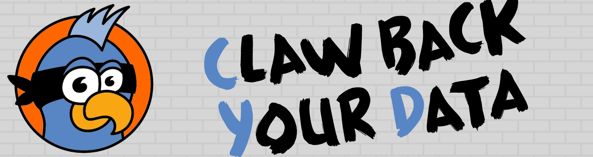
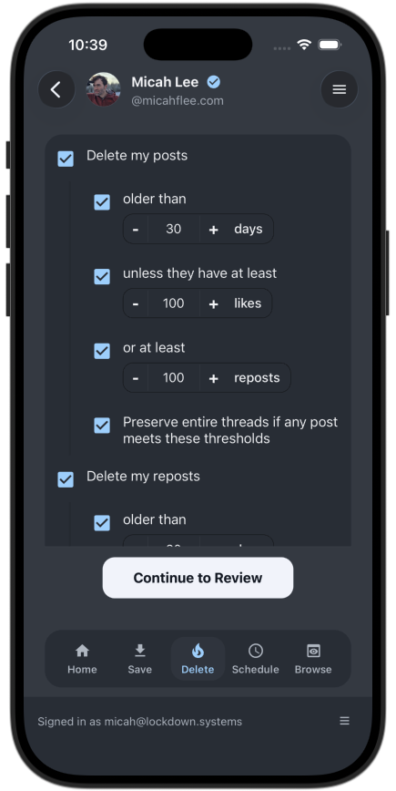

# Cyd Mobile: Claw back your data from Bluesky

Most tech platforms are controlled by a tiny group of powerful billionaires. You don't _owe_ them your data. Even posting to Bluesky is a privacy nightmare.

Cyd Mobile is the iPhone and Android version of [Cyd](https://cyd.social/), and it helps you to control your data in Bluesky.

With this app, you can:

- **Create a local, private backup of your data**, including Bluesky posts, reposts, likes, bookmarks, and chat messages.
- **Choose what you want to delete.** You can delete it all, or you can be selective, deleting most of it but keeping what went viral.
- **Schedule automatic deletion**, keeping your online data as ephemeral as you want over time.

**Want to claw back your data from X (and soon Facebook)?** [Cyd Desktop](https://github.com/lockdown-systems/cyd), for Windows, Mac, and Linux, helps you control your data on those platforms.

## Be patient

Cyd Mobile is under active development and testing. When it's ready, it will be available in the iPhone App Store and the Android Play Store.

## Android builds

There are two Android builds of Cyd Mobile:

- **Play Store build** (`systems.lockdown.cydmobile`) — sold and distributed through Google Play, with Premium In-App Purchases via Google Play Billing. This is what `npm run build:android` and the release workflow's `build_android` job produce, and what `npm run submit:android` uploads to the Play Console's internal testing track.
- **Non-Play build** (`systems.lockdown.cydmobile.alt`) — a direct download from our website, which keeps the external Stripe checkout. Build it with `npm run build:android:alt` (EAS profile `production-android-alt`) or run it locally with `npm run android:alt`.

Which build you get is decided at build time by `ANDROID_DISTRIBUTION` (`play`, the default, or `other`), mirroring how `IOS_DISTRIBUTION` selects the iOS App Store and alt-store builds.

Setting up the non-Play build for the first time requires two manual steps: a new signing keystore, and registering `systems.lockdown.cydmobile.alt` in the Firebase console so push notifications work (commit the downloaded config as `google-services-alt.json`). The keystore cannot be the Play upload keystore: EAS tracks Android credentials per application ID, so building the `production-android-alt` profile will offer to create a new keystore, and the release workflow expects it as the `ANDROID_ALT_*` secrets.

## Documentation

Learn all about how to use Cyd, what features it has, and how to get involved in the open source project, including how to request features and report bugs, at the [Cyd Documentation](https://docs.cyd.social) website.
